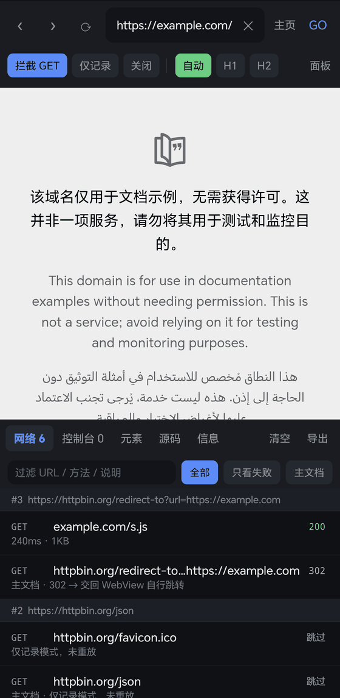
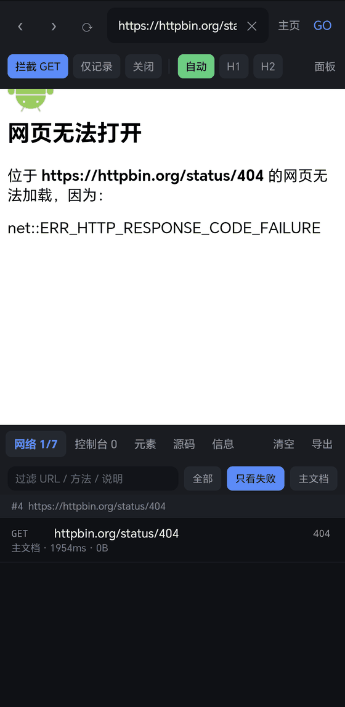
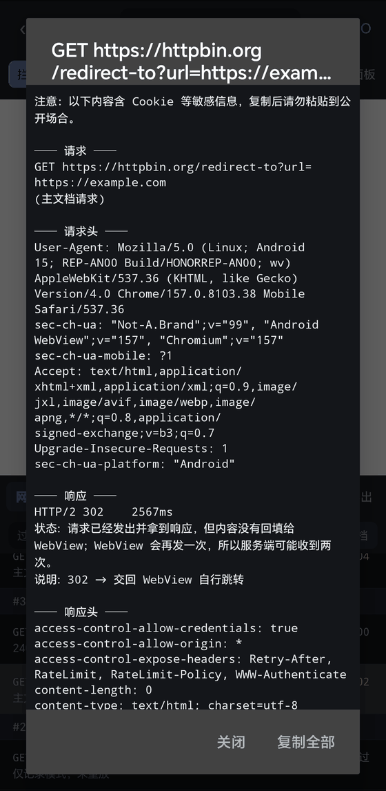

# PhoneInspect

[](https://github.com/hehua04/phoneinspect/actions/workflows/build.yml)

**在手机上直接看每个请求的完整响应头和真实状态码** —— 不接电脑、不用 USB。包括 JS 层永远读不到的 `Set-Cookie`、重定向链，以及 301/302 本身。

**EN** · An on-device network inspector for Android WebView. Requests are replayed through its own HTTP stack, so you see real status codes, redirect chains and `Set-Cookie` — things page-level JS (Eruda, vConsole) can never read. No PC, no USB, no Gradle: `bash build.sh` produces a ~250KB APK.

<p align="center">
  
  
  
</p>

> **只用于调试你自己拥有、或已获授权调试的站点。** 所有数据只在本机：没有账号、没有上传、没有统计、没有第三方 SDK。

## 快速开始

1. 下载 `PhoneInspect.apk` 传到手机安装（需允许未知来源），或 `adb install -r PhoneInspect.apk`
2. 打开 App，在顶部输入网址 —— 页面就在 App 内打开
3. 底部面板五块：网络 / 控制台 / 元素 / 源码 / 信息

仓库里的包用本机 debug key 签名。**你自己重新构建的包签名不同，无法覆盖安装**，需要先卸载（会丢数据）。

minSdk 26（Android 8+），无原生库，不分 32/64 位。

## 为什么不用 Eruda / vConsole

那类工具 hook 的是页面里的 `XMLHttpRequest` 和 `fetch`，撞三条规范墙：

- 跨域请求只能读到 CORS 安全列表里的响应头
- `Set-Cookie` 是 forbidden response header，任何 JS 手段都读不到
- 导航请求（HTML 文档本身）、CSS/JS/图片、重定向链全在 hook 范围外

PhoneInspect 把拦截搬到 WebView 的原生层，用 OkHttp（`libs/okhttp-3.14.9.jar`）把请求重发一次。重发不经过页面的 fetch，**CORS 根本不适用**，所以第三方站点的响应头同样能看全。

## 三档模式

| 模式 | 行为 | 用在哪 |
|---|---|---|
| **拦截 GET**（默认） | 原生层重发 GET，拿到状态码、全部响应头、`Set-Cookie`、重定向链、响应体前 6KB，再回填给 WebView | 排查接口问题 |
| **仅记录** | 只记 URL 和请求头，不动真实流量 | 怀疑拦截本身引起异常时对照 |
| **关闭** | 完全等同普通浏览器 | 定位问题时做减法 |

底部面板分 **网络 / 控制台 / 元素 / 源码 / 信息** 五块。控制台自动注入钩子，捕获 `console.*`、未捕获异常和 Promise 拒绝。点任意请求可看分组详情，支持整份复制导出。

顶栏：`‹` `›` `⟳` 前进后退刷新，`主页` 回到内置引导页（跳回历史第一条，不新增记录），输入框右侧的 `✕` 一键清空（有内容时才出现）。

### 协议选择

模式行右侧三个绿色胶囊可以随时切换重放连接使用的协议：

| 选项 | `protocols()` | 语义 |
|---|---|---|
| **自动**（默认） | `[HTTP_1_1, HTTP_2]` | h2 优先，服务端不支持则回落 h1，最接近浏览器 |
| **H1** | `[HTTP_1_1]` | 真能强制降级，服务端都支持 h1 |
| **H2** | `[HTTP_1_1, HTTP_2]` + 结果检查 | 不是"只接受 h2"。OkHttp 3.x 的 `protocols()` 要求列表里必须有 h1，没法靠列表强制；实际做法是协商完再检查 `response.protocol()`，不是 h2 就记一条「服务端没协商到 HTTP/2」并把页面交回 WebView |

因为没法在 ALPN 层强制，H2 选项的语义是「探测」而不是「强制」：连上之后看协商结果，不是 h2 就记一笔（`Replay.java:206-214`），页面交给 WebView 正常加载。切换协议后会自动重新加载当前页面，因为已加载的页面不会中途换协议。

详情页展示的是 `response.protocol()` 的真实结果，不是猜的。

## 元素检查 / 源码 / 执行 JS

面板有 5 个标签，tab 行可横向滚动：网络 / 控制台 / 元素 / 源码 / 信息。

**元素** —— 点「开始拾取」后点页面元素，显示标签、id/class、CSS 选择器路径、位置尺寸和十余条关键计算样式，页面上有高亮框跟随滚动。拾取模式下页面不响应点击，但可以正常滚动（位移超过 10px 视为滚动，不触发选取）；换页面会自动退出。

**源码** —— 两个视图，差别本身就是线索：

- **原文**：拦截层拿到的服务器响应字节，解码后展示。这是真正的 `view-source`，注释、原始缩进、还没被 JS 渲染的模板都在，上限 512KB。原文里有、DOM 里没有的东西，就是被 JS 改写掉的。
- **DOM**：`document.documentElement.outerHTML` 快照，反映 JS 执行后的结构。分片回传避免 IPC 大包，上限 800KB。

**控制台** —— 底部输入框在页面上下文执行 JS，结果显示为紫色 `[eval]` 日志。用 `eval` 而不是函数包裹，`return` 和局部变量声明都是正常语义。

## 崩溃日志
App 会接管未捕获异常，把堆栈写到 `Android/data/com.phoneinspect/files/crash/`（保留最近 5 份），下次启动时自动出现在「控制台」里，不需要连电脑。

要看实时日志还是得用 adb：

```bash
adb logcat -b crash -d          # 只看崩溃缓冲区
adb logcat AndroidRuntime:E *:S # 只看异常
```

## 版本

版本号唯一来源是 `version.properties`，`build.sh` 读它并通过 `aapt2 --version-code/--version-name` 注入，清单里不写死，避免两处漂移。

```
versionCode=21
versionName=1.4.0
```

改完直接 `bash build.sh`，App 内「信息」面板会显示当前安装的版本。每次发版记得 `versionCode` +1；加功能升中版本，修问题升修订号。

### 变更记录

**1.4.0** —— 从"能看到"补到"看得懂"

- **记录四态**：已接管 / 未发送 / 已探测未接管 / 失败，分别用绿、灰、橙、红。不再是满屏红 `ERR`，POST 埋点也不再被当成接口全挂。
- **导航分段**：列表按页面分成 `#1 / #2 / #3`，换页后旧记录不丢也不混，详情页能看到"这条是在哪个页面上发的"。
- **搜索与筛选**：网络页支持 URL / 方法 / 说明关键字和「只看失败 / 主文档」；控制台支持日志关键字和「警告+ / 错误」。tab 上显示 `1/75`，不会误以为请求只有一条。
- **清缓存**：信息页可以清 HTTP 缓存（含 301 跳转记录）或连 Cookie 一起清。301 被永久缓存导致"服务端改了浏览器还跳老地址"时用得上。
- **列表数据层**：记录带稳定 id，点击按 id 反查。修复加载中点第 3 行打开第 4 条，以及 `IllegalStateException: The content of the adapter has changed` 导致的进程崩溃。
- **流式转发**：超过 4MB 和流媒体改为边下边传，不再"读一截丢弃再让 WebView 重发"，服务端只收到一次请求。
- **换页取消**：切页面时叫停上一页还在跑的请求，被取消的不记为失败。

**1.3.7** —— 自签证书站点可选「继续访问」。

## 构建

不需要 Gradle，也不需要 Android Studio。工具链是 `aapt2 + javac + d8 + zipalign + apksigner`。

```bash
bash build.sh        # 只构建，产物在根目录 PhoneInspect.apk
bash deploy.sh       # 构建 + 校验 + 安装到设备（推荐）
```

`deploy.sh` 存在的理由：`bash build.sh | tail -3 && adb install ...` 这种写法里，管道的退出码是 `tail` 的，**构建失败也会继续往下走**，于是把仓库里上一次残留的 APK 装到手机上，看起来像「先装了旧包再装新包」。`deploy.sh` 会检查构建退出码、比对 APK 与 `version.properties` 的版本、装完再回读设备上的 versionCode，任一步不符就中止。

首次运行会自动调用 `bootstrap.sh` 下载 build-tools 35 与 platform 35（约 120MB）到 `sdk/`。这一步是**从 Google 官方源下载 SDK 组件**，和安装 Android Studio 里勾选的是同一批文件。

依赖：JDK 11+、`curl`、`unzip`、`python3`（用于把 `classes.dex` 合进 APK，因为 Git Bash 没有 `zip`）。

## 原理

```
WebView 请求
   ↓
WebViewClient.shouldInterceptRequest()      ← 后台线程，可阻塞
   ↓
Replay.fetch()  用 OkHttp 重发一次（协议可选）
   ↓ 逐跳处理 3xx，记录重定向链，Set-Cookie 写回 CookieManager
WebResourceResponse(mime, enc, status, reason, headers, data)
   ↓
WebView 拿到"看起来像正常响应"的内容并渲染
```

几个必须踩过才知道的坑，代码里都处理了：

- **`getRequestHeaders()` 默认不含 Cookie**。WebView 故意不把它放进请求头，必须自己 `CookieManager.getCookie(url)` 取；而且每一跳都要重新取，跳转后域名和路径变了才是正确的那份
- 重发时**丢掉** `Accept-Encoding`，交给 OkHttp 自动协商并解压
- 重发时**丢掉** `If-None-Match` / `If-Modified-Since`，否则服务端返回 304 空包，页面直接白屏
- 回给 WebView 的头**必须删掉** `Content-Length` / `Content-Encoding` / `Transfer-Encoding`，因为 body 已被解压，长度和原头对不上会导致渲染失败
- `Set-Cookie` 不能靠响应头传给 WebView，要逐条写进 `CookieManager` 再 `flush()`
- **主文档的 3xx 只能记不能拦**。`WebResourceResponse` 的构造器硬性禁止 300–399，会直接抛 `IllegalArgumentException: statusCode can't be in the [300, 399] range`。所以主文档遇到 3xx 只能记下真实状态码和响应头，然后 `return null` 交给 WebView 自己重新请求并跟随跳转。代价是这次重放白发一遍，好处是文档 URL 由 Chromium 维护，页面里的相对路径不会解析错。子资源的 3xx 仍由工具手动跟随，能记全链路
- **缺 `Content-Type` 不能给 `octet-stream`**。HTML 会被当成二进制，页面静默白屏且不报错。要按扩展名兜底再嗅探内容
- **响应头没 charset 时不能硬编码 utf-8**。国内老站大量是 GBK，得先看 `<meta charset>`，再判断是否合法 UTF-8，都不是才回落 GBK
- **响应体不能先全读再截断**。`body().bytes()` 会把整个视频流读进内存，得边读边计数、超限立即中断返回 `null`
- **深色渲染要三个 API 一起关**。`WebView.setForceDarkAllowed(false)` 在部分 WebView 上不生效，还得加 `WebSettings.setForceDark(FORCE_DARK_OFF)`，并给页面注入 `<meta name="color-scheme" content="light">`。否则页面会被当成深色主题渲染：`<p>` 的计算颜色是 `rgb(255,255,255)`，白底黑字的页面直接变成黑底白字
- **软键盘的回车在部分输入法上会触发两次** `onEditorAction`，一次导航发两遍请求。`go()` 里对同一地址做了 600ms 去抖

## 已知限制

- **HTTP/2 能看，HTTP/3 不能**。协议可切（自动 / 仅 h1 / 仅 h2）。但 OkHttp 从来没正式支持 QUIC，早年那个 `okhttp-quic` 分支早已废弃，所以 HTTP/3 完全看不到，QUIC 站点会退回 h2 或 h1。要看 HTTP/3 只能换 Cronet（包体积 10MB+）。
- **h2 只是"能连"，不是"等同浏览器"**。`shouldInterceptRequest` 是每请求一次阻塞调用，单例 OkHttpClient 的连接池能复用连接、多路复用流，但 h2 优先级、流依赖、103 Early Hints 这些调度行为拿不回来。
- **协议只管被拦截的请求**。POST、WebSocket、Service Worker 不走这里，仍然由 WebView 自己决定协议。
- **拿不到 POST 请求体**。`WebResourceRequest` 不提供 body，所以非 GET 请求只记录 URL 和请求头、不重发。
- **超大与流媒体只透传、不留内容**。超过 4MB、或 `video/` `audio/`/SSE 这类流，直接交给 WebView 边下边传，面板只保留开头 8KB——服务端只收到一次请求，但你看不到完整响应体。
- **主文档的 3xx 不做重放**。能看到状态码和响应头，但响应体由 WebView 重新请求获取，这类跳转实际会发两次请求。
- **iframe 里的 console 收不到**。`evaluateJavascript` 只作用于主 frame，跨域 iframe 的日志拿不到。
- **跨域 iframe 里的元素选不进去**。同源 iframe 可以，跨域只能选到 iframe 这一层。
- **DOM 快照有失真**。不含 shadow DOM，`<input>` 的当前输入值也不在 `outerHTML` 里（那是属性不是属性值）。
- **源码原文依赖拦截模式**。需要处于「拦截 GET」并刷新一次页面，否则「原文」视图是空的。
- **JS 桥 `PI` 对所有页面开放**。恶意页面理论上能刷日志（有 500 条上限，风险很低）。只在调试自己的站点时用。
- **导出写文件不写剪贴板**。记录含 `Set-Cookie`，剪贴板对其它 App 可读。文件落在 `Android/data/com.phoneinspect/files/export/`。
- **每个 GET 多一次往返**。实测 24 张同域图（每张 300ms 延迟）拦截模式 2.0s、原生 3.0s；延迟极高的网络下仍会比原生慢一点。
- 记录只存在内存里，切后台被回收就没了，最多保留 400 条。

### 这些不打算做

公开 issue 之前先看这里，省得互相等：

- **HTTP/3 / QUIC**。OkHttp 从来没正式支持，要看只能换 Cronet（+10MB）。
- **POST 请求体**。`WebResourceRequest` 根本不提供，改不了。
- **Service Worker 注册与 CacheStorage 清理**。「清缓存」只清 HTTP 缓存和 DOM Storage，SW 需要另一套 API，收益低于复杂度。
- **macOS 构建脚本**。`bootstrap.sh` 只写了 Windows/Linux 两条分支，mac 用户可以手动放 SDK。
- **HAR 导出**。现在只有 txt。真要 HAR 得处理 base64 body 和 `_initiator` 字段，且大响应落盘会吃掉手机存储。
- **把记录持久化到磁盘**。会顺带把 Cookie 写进文件，风险大于收益。

## 目录

```
app/
  AndroidManifest.xml
  res/                          自适应图标
  java/com/phoneinspect/
    MainActivity.java           界面、WebView、三档模式、JS 桥
    Replay.java                 重发与响应头抓取（核心）
    Net.java                    数据模型与内存存储
    PanelAdapter.java           请求列表 / 日志列表
    Detail.java                 请求详情弹窗
libs/
  okhttp-3.14.9.jar             纯 Java 版 OkHttp（非 4.x 的 Kotlin 版）
  okio-1.17.2.jar               OkHttp 依赖
bootstrap.sh                    下载 SDK 组件
build.sh                        一条命令出 APK
docs/                           README 用截图
```

## 自签名证书

访问证书不受信任的站点（自签名、证书链不完整）时会弹窗，可选「继续访问（不安全）」。确认后该 `host:port` 在本次运行内被记住，重放层与 WebView 都不再校验它的证书。

两条链路都要处理：我们自己的 OkHttp 重放，和 WebView 自己的请求（POST、未拦截的资源）。弹窗统一走 `onReceivedSslError` —— 重放失败后返回 `null`，WebView 会重试并触发它，所以在那一处弹一次即可。

例外只在进程内有效，重启 App 会重新询问；这是刻意的，避免一次误点变成长期后门。

## 使用边界

这个工具会把请求重放到自己的网络栈里，所以能拿到 `Set-Cookie`、真实状态码和完整重定向链；它也能在用户确认后，对指定站点信任任意证书。

**只用在你自己拥有的、或已获授权调试的站点上。**

- 所有数据只存在本机：没有账号、没有上传、没有统计、没有第三方 SDK。
- 为了让 `chrome://inspect` 能接进来做对照，App 无条件开启了 `WebContentsDebuggingEnabled`——能通过 adb 连上这台手机的人，也能查看这个 WebView 里的内容（包括 Cookie）。介意的话别在有敏感登录态的机器上用。
- 「继续访问（不安全）」只在本次进程内有效，重启即失效，不会变成长期后门。

## 许可

MIT，见 [LICENSE](LICENSE)。内置依赖 OkHttp 与 Okio，均为 Apache-2.0，详见 [THIRD-PARTY.md](THIRD-PARTY.md)。
